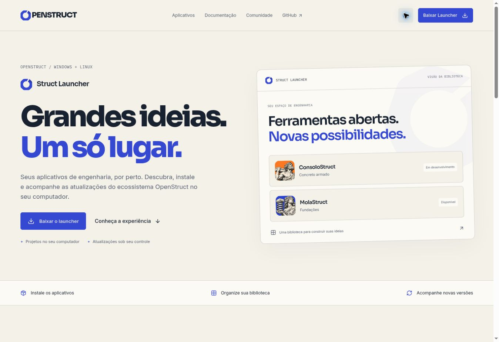

# OpenStruct

Frontend do ecossistema OpenStruct: ferramentas abertas para engenharia estrutural. O site apresenta o projeto, o catálogo e as páginas do ConsoloStruct e do MolaStruct.

## Desenvolvimento

Requisitos: Node.js 24 LTS e npm.

```sh
npm ci
npm run dev
```

```sh
npm run build     # TypeScript + build de produção
npm run preview   # Servir o build localmente
```

O projeto usa React, TypeScript, Vite e React Router. O CSS é próprio. As fontes são hospedadas localmente; não há serviços externos obrigatórios, autenticação ou backend.

## Páginas

| Endereço              | Conteúdo                                                                          |
| --------------------- | --------------------------------------------------------------------------------- |
| `/`                   | Apresentação, aplicativos, ConsoloStruct em destaque, princípios e FAQ            |
| `/apps`               | Catálogo com busca e filtros; futuros aplicativos identificados como planejamento |
| `/apps/consolostruct` | Página do aplicativo, prévia interativa, recursos em desenvolvimento e acesso     |
| `/apps/molastruct`    | Página do MolaStruct, esquema de fundações, escopo inicial e métodos previstos    |
| `/launcher`           | Downloads oficiais Windows/Linux, versão publicada e instruções de instalação     |
| `/docs`               | Guia inicial com busca, unidades, limitações da prévia e participação             |
| `/community`          | Formas de contribuir e acompanhar o projeto                                       |
| Outros endereços      | Página 404 com navegação de retorno                                               |

ConsoloStruct e MolaStruct possuem páginas de produto e aparecem na central de aplicativos. Os demais nomes no catálogo representam o planejamento do ecossistema.

## Struct Launcher e downloads

A página `/launcher` consulta o feed público de atualização do próprio launcher:

```text
https://raw.githubusercontent.com/ricardocorsini/openstruct-catalog/main/launcher/latest.json
```

Quando o fluxo de publicação e a sincronização do hub terminam, a página oferece os dois
instaladores reais da versão estável: Windows x86_64 (.exe/NSIS) e Linux x86_64 (AppImage).
Os links não ficam fixos na versão 0.2.0. Uma nova versão do feed atualiza a página na próxima
consulta, sem outro deploy do site. O botão de verificação permite consultar novamente.

Antes da primeira publicação, o feed responde 404 e a página informa que os instaladores
estão em preparação. Falhas de rede ou metadados inválidos mostram um estado de erro com
opção de repetir e link para os lançamentos. Nenhum botão inicia um download inexistente.

O leitor aceita somente URLs HTTPS com os nomes canônicos, produto, repositório, versão e
formatos esperados. Exige os dois pacotes e a presença das assinaturas no feed. A validação
criptográfica dos instaladores e atualizações é feita pelo launcher; o site não apresenta a
validação de formato do feed como uma verificação criptográfica.

Os downloads não exigem login GitHub. A sugestão de sistema é apenas visual: os dois formatos
ficam visíveis, inclusive no celular. macOS/ARM não são anunciados como alvos nativos.

O MolaStruct já tem release desktop; o ConsoloStruct aguarda sua primeira publicação.
Os endereços e o leitor estão em `src/lib/launcher.ts`. Execute `npm test` para verificar
seleção de arquivos, publicações incompletas, origens inválidas e estados de rede.

A conferência visual incluiu navegação pela home e central de aplicativos, nova consulta ao
feed, temas claro/escuro e layout com largura de 454 px sem rolagem horizontal. O feed oficial
já oferece a primeira versão pública do launcher, 0.2.1, com pacotes assinados no hub. O leitor
real retornou `ready` e a página pública exibiu os dois downloads com as URLs corretas. Novas
releases estáveis entram pelo mesmo feed, sem editar os links do frontend.



## Links e integrações opcionais

Copie `.env.example` para `.env.local` e preencha os endereços que estiverem disponíveis:

```dotenv
VITE_CONSOLOSTRUCT_URL=https://seu-aplicativo.example
VITE_CONSOLOSTRUCT_REPOSITORY=https://github.com/seu-usuario/seu-repositorio
VITE_CONSOLOSTRUCT_DOWNLOAD_URL=https://seu-download.example
VITE_MOLASTRUCT_URL=https://seu-molastruct.example
VITE_MOLASTRUCT_REPOSITORY=https://github.com/seu-usuario/seu-molastruct
VITE_MOLASTRUCT_DOWNLOAD_URL=https://seu-download-molastruct.example
VITE_DISCORD_URL=https://discord.gg/seu-convite
```

Os valores são incorporados durante o build. O botão “Baixar Launcher” abre a página de
downloads; a central “Abrir aplicativos” continua disponível no rodapé com acesso às páginas
e prévias. Os repositórios de ConsoloStruct e MolaStruct e os lançamentos do MolaStruct já têm
endereços oficiais por padrão. O Discord exibe um aviso de preparação e oferece o GitHub como
alternativa enquanto o convite não for configurado.

Os outros links e os dados do catálogo ficam em `src/lib/config.ts`.

## Prévia do ConsoloStruct

A demonstração é uma representação esquemática em SVG. Permite alternar entre modelo, armadura e detalhe, ajustar a projeção de 25 a 60 cm, separar camadas e restaurar o exemplo. **Não executa cálculo, dimensionamento, verificação normativa ou geração de desenho para obra.** Os recursos de cálculo descritos na página são identificados como objetivos de um aplicativo em desenvolvimento.

## MolaStruct

A página do MolaStruct apresenta o escopo inicial informado para estimativa da rigidez à translação e à rotação do conjunto fundação + solo. Reúne geometria, perfil de sondagem e características do solo, com sapatas e blocos de 1 a 4 estacas.

Mindlin, Steinbrenner, molas de Winkler e Teoria da Elasticidade são apresentados no contexto de deformabilidade e rigidez. Aoki–Velloso aparece no contexto da capacidade de carga das estacas; Terzaghi, Vesic e correlações com SPT, nas estimativas de ruptura em sapatas. A NBR 6122:1996 é identificada como referência histórica da descrição inicial, sem alegação de conformidade normativa atual.

O componente `FoundationPreview` permite alternar entre sapata e bloco, com 1, 2, 3 ou 4 estacas. **É um esquema conceitual de apresentação, sem cálculo de rigidez, recalque ou capacidade de carga.** Os detalhes técnicos e a integração com o aplicativo serão acrescentados posteriormente.

## Identidade visual

| Cor           | Código    | Uso                      |
| ------------- | --------- | ------------------------ |
| Cobalto       | `#3448D1` | Marca e ações principais |
| Laranja solar | `#FF8A3D` | ConsoloStruct            |
| Âmbar         | `#F4C95D` | Destaques                |
| Aço           | `#B8C5D6` | Apoio                    |
| Grafite       | `#18212F` | Texto e tema escuro      |
| Marfim        | `#F4F1E9` | Fundo principal          |

Tipografia: Sora para marca e títulos, Inter para interface e leitura, IBM Plex Mono para informações técnicas. O monograma O tem uma versão vetorial em `public/assets/openstruct-mark.svg`. As ilustrações originais de Atlas (ConsoloStruct) e da Terra sustentando uma mola e uma fundação (MolaStruct) foram criadas para este projeto com geração de imagem. O ícone do MolaStruct está em `public/assets/molastruct-gaia.webp`.

As fontes WOFF2 são subconjuntos para idiomas latinos. Seus avisos SIL Open Font License estão em `public/fonts/`. A geometria do monograma está em `src/components/Brand.tsx`; o desenho esquemático em `src/components/CorbelModel.tsx`.

## Publicação

O build estático é gerado em `dist/`. Há configurações para Vercel, Netlify e serviços que aceitam `_redirects`. Em outro servidor, configure o fallback das rotas do React Router para `index.html`:

```nginx
location / {
  try_files $uri $uri/ /index.html;
}
```

A publicação e a configuração do domínio `openstruct.com.br` são independentes do envio do código ao GitHub.

## Estrutura

```text
src/
  components/  # Marca, layout, cartões, central de aplicativos e demonstração
  lib/         # Configuração central e catálogo
  pages/       # Páginas e navegação
  styles.css   # Identidade, temas e layouts responsivos
public/
  assets/      # Ilustrações dos aplicativos e monograma
  fonts/       # Fontes locais e licenças
```

O tema é persistido no navegador, com preferência clara na primeira visita. A interface inclui links de salto, foco visível, menu móvel, controles com rótulos e respeito a movimento reduzido. A central de aplicativos usa um diálogo nativo com navegação por teclado.

## Contribuição

Abra uma issue descrevendo o contexto, o comportamento esperado e, quando possível, passos para reproduzir. Para mudanças de código, execute `npm run build` antes de abrir uma pull request. O workflow de CI repete o build em pushes e pull requests.

Licença MIT. As fontes mantêm suas próprias licenças OFL.
