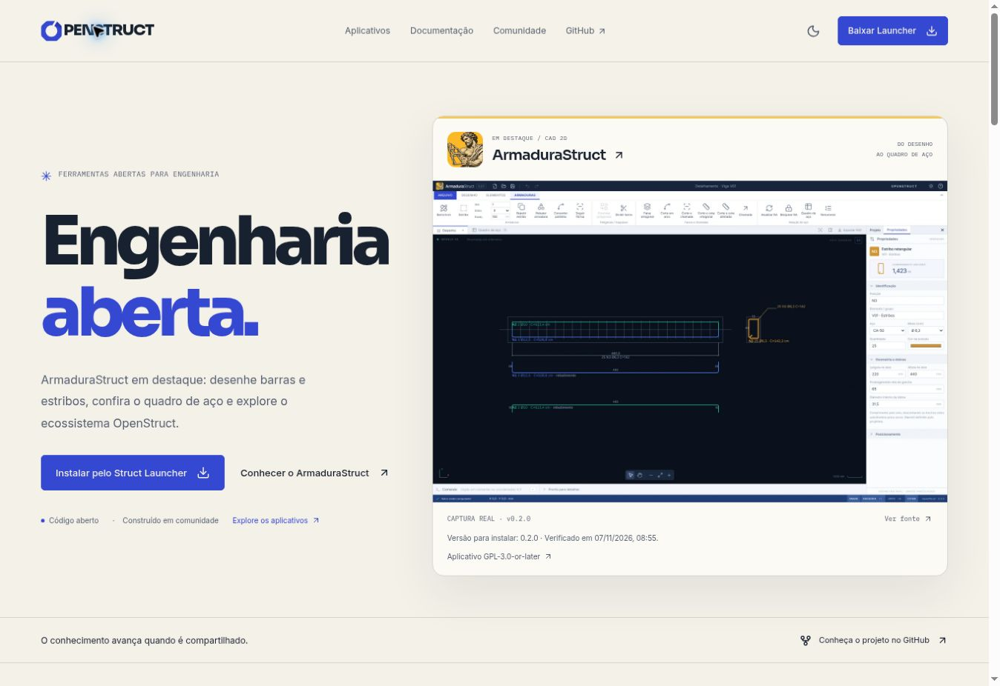

# Destaque do ArmaduraStruct na home — OSF-07

Revisão de **07/11/2026**, a partir do frontend
`8363ad2eabb69dd27b910c46023b62de4ed7231d`. As bases OSF-04, OSF-05 e OSF-06
já estavam implementadas: conteúdo conferido por tag, catálogo assinado compartilhado
e instalação prioritária pelo Struct Launcher.

## Imagem e conteúdo revisados

O catálogo público consultado nesta revisão mantém **ArmaduraStruct 0.2.0** no
canal estável, para Windows/Linux x86_64. A data de publicação do catálogo é
`2026-11-06T22:43:45.682Z`. O site continua consultando o catálogo validado em
tempo de uso; a revisão editorial não fixa a versão disponível.

| Item                                     | Evidência                                                                                                                                                                                                                                         |
| ---------------------------------------- | ------------------------------------------------------------------------------------------------------------------------------------------------------------------------------------------------------------------------------------------------- |
| Versão da captura e do fluxo apresentado | 0.2.0, tag `v0.2.0`, commit `c25baa3b6b914670eccc58e40c87e06732d9019b`                                                                                                                                                                            |
| Origem pública da captura                | [docs/preview.png](https://github.com/ricardocorsini/armadura-struct/blob/c25baa3b6b914670eccc58e40c87e06732d9019b/docs/preview.png), blob Git `c09d1aa35fafb5f35e9b58909411cd0a580e9497`                                                         |
| Documentação do fluxo e dos limites      | [GUIA.md da tag](https://github.com/ricardocorsini/armadura-struct/blob/c25baa3b6b914670eccc58e40c87e06732d9019b/docs/GUIA.md), seções Espaço de trabalho, Posições de armadura, Relação de aço e conferência, Comprimento e Importação e entrega |
| Pacotes consultados                      | [Catálogo assinado](https://github.com/ricardocorsini/openstruct-catalog/blob/main/catalog.signed.json) e [release armadurastruct-v0.2.0](https://github.com/ricardocorsini/openstruct-catalog/releases/tag/armadurastruct-v0.2.0)                |
| Arquivo local reutilizado                | `public/assets/armadurastruct-editor.webp`, 1600 × 1000, 58.090 bytes (aproximadamente 57 KiB)                                                                                                                                                    |
| SHA-256 do WebP                          | `225e05e09aaabe67942d81a5a800a99b2c22eaeeba51821ad71ace2ab64f2ebc`                                                                                                                                                                                |
| Data da revisão da imagem e do conteúdo  | 2026-11-07                                                                                                                                                                                                                                        |
| Licença do aplicativo                    | [GPL-3.0-or-later](https://github.com/ricardocorsini/armadura-struct/blob/c25baa3b6b914670eccc58e40c87e06732d9019b/LICENSE), independente da licença MIT do site                                                                                  |

O WebP já existente foi comparado visualmente com o PNG oficial da tag e permanece
inalterado. Mostra o exemplo público Viga V01, barras longitudinais, estribo N3,
cotas, rebatimentos, faixa de ferramentas e propriedades. A aba Quadro de aço
pertence ao ambiente, mas a tabela completa não está aberta nessa captura. Os
quantitativos são explicados pelo fluxo editorial e documentados no guia, sem
adicionar uma tabela fictícia à imagem. Não foram utilizados projetos privados,
telas da master ou elementos técnicos gerados por IA.

## Composição e limites

- A primeira dobra apresenta o CAD real com Hefesto como identidade complementar.
  A imagem inteira mantém a proporção 8:5, sem deformação ou corte de ferramentas,
  propriedades e exemplo. Seu link abre a seção do editor na página do produto;
  a fonte original pode ser aberta separadamente para examinar os detalhes.
- O primeiro cartão da home passa a ser ArmaduraStruct. A ordem do registro,
  os números públicos, os IDs e as rotas dos demais aplicativos são preservados.
- O segundo destaque usa um fluxo em quatro etapas em vez de repetir a captura:
  máscara DXF/DWG → barras/estribos/posições → quadro de aço → projeto/DXF/PDF/CSV.
  Os recursos são identificados como **da versão 0.2.0**, mesmo que um novo pacote
  seja disponibilizado no catálogo posteriormente.
- DWG é entrada como máscara, com as limitações descritas na página do produto.
  O projeto editável permanece `.armstruct.json` (`armadurastruct/2` nessa tag);
  as saídas são DXF, PDF A3 e CSV. Detalhamento e verificações de projeto continuam
  sob responsabilidade do projetista. Hierarquia, pranchas e formatos posteriores
  não são promovidos na home como parte dessa versão.
- A versão para instalar e sua data de consulta vêm de `ProductCatalogMeta` e do
  catálogo assinado da OSF-05, inclusive seus estados de contingência. Não há
  consulta ou versão de disponibilidade paralela nem download avulso na home.
- A prévia interativa do ConsoloStruct continua em sua página própria.

`src/lib/product-media.ts` registra versão, dimensões, texto alternativo, origem,
commit e revisão da captura. Home e página de ArmaduraStruct consomem esse mesmo
registro. O destaque usa a imagem com prioridade alta e dimensões explícitas; a
página do produto mantém carregamento tardio. O WebP não foi reprocessado.

## Como atualizar o destaque

1. Confirmar a distribuição por ID/canal no catálogo assinado e localizar a tag
   exata de origem. Um README mais recente ou a versão da master não comprova
   o conteúdo do instalador.
2. Conferir cada etapa do fluxo contra o guia dessa tag. Atualizar os textos e o
   registro de mídia somente após reunir a evidência correspondente.
3. Reutilizar uma captura oficial pública da tag ou produzir uma captura real
   reproduzível na versão publicada, registrando o exemplo aberto, ambiente,
   origem e commit. Preservar os pixels técnicos; não reconstruir a interface.
4. Ao trocar o arquivo, otimizar o tamanho, conferir dimensões, texto alternativo
   e rótulo da versão em ambos os consumidores. Não rotular uma imagem antiga
   com a versão recebida pelo catálogo em tempo de uso.
5. Rever desktop/mobile e ambos os temas, links para produto/Launcher, fonte,
   quadro de fluxo e acesso aos demais aplicativos. Executar `npm test` e
   `npm run build`.

As evidências detalhadas dos recursos permanecem no
[mapa da OSF-04](ARMADURASTRUCT-PUBLICADO.md). Esta tarefa modifica somente a
apresentação web; não executa ou altera o CAD, seus importadores, exportadores ou
motores de engenharia.

## Verificação da entrega

- `npm test`: 39 testes aprovados, incluindo contratos e contingência do catálogo
  e as regras compartilhadas de instalação.
- `npm run build`: TypeScript e Vite aprovados; formatação e `git diff --check`
  sem erros.
- Inspeção em navegador com largura desktop de 1348 px e largura móvel de
  aproximadamente 337 px, obtida por zoom do navegador, nos temas claro e escuro.
  Hero, imagem integral, fontes, cartões e fluxo não geraram rolagem horizontal.
  Não houve execução em aparelho físico.
- Navegação da home para ArmaduraStruct, seção do editor e Struct Launcher
  conferida. Instalação e cálculos do aplicativo desktop não fazem parte desta
  verificação; as afirmações do produto se apoiam na tag e no guia acima.
