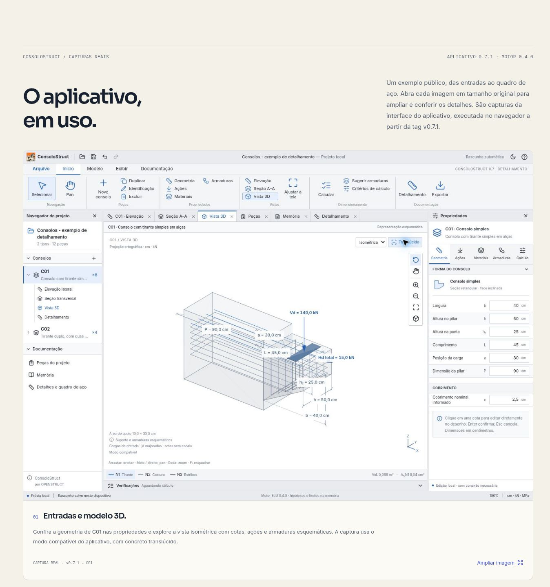

# Capturas reais do ConsoloStruct — OSF-08

Revisão de **07/11/2026**, sobre o frontend
`4fb007e69553bbaa511ad5b5520d14849ef3dcc9`.

A OSF-02 já apresentava a distribuição, o fluxo e o escopo técnico da 0.6.0.
A OSF-10 ainda não está implementada: esta entrega usa figuras e links nativos
para os arquivos originais, sem antecipar um carrossel ou diálogo de galeria.

## Fonte e versão

O catálogo público consultado em 07/11/2026 já oferece o aplicativo **0.7.1** para
Windows/Linux x86_64. Seu envelope registra publicação em
`2026-11-07T12:23:39.598Z`. As docs dessa tag não contêm capturas da interface;
por isso as imagens foram produzidas executando o código oficial, sem alterações:

- [Tag v0.7.1](https://github.com/ricardocorsini/consolo-struct/tree/v0.7.1), commit
  **`f5267af015b77741b5e31b2a1900056bf43f7740`**.
- [package.json](https://github.com/ricardocorsini/consolo-struct/blob/f5267af015b77741b5e31b2a1900056bf43f7740/package.json): aplicativo **0.7.1**.
- [Guia da versão](https://github.com/ricardocorsini/consolo-struct/blob/f5267af015b77741b5e31b2a1900056bf43f7740/docs/GUIA-DE-USO.md): arquivos, entradas, Calcular/Memória, vistas e detalhamento.
- [README](https://github.com/ricardocorsini/consolo-struct/blob/f5267af015b77741b5e31b2a1900056bf43f7740/README.md): motor **0.4.0**, política **LC-ELU-2026.2**, execução web e limites.
- [Exemplo público](https://github.com/ricardocorsini/consolo-struct/blob/f5267af015b77741b5e31b2a1900056bf43f7740/examples/detalhamento/consolos-detalhados.lume.json):
  **Consolos - exemplo de detalhamento**, peça **C01**, oito unidades. Dados
  fictícios, sem cliente privado ou dados pessoais. O arquivo foi aberto sem
  modificar seus parâmetros; o SHA-256 está no manifesto.
- [Licença MIT](https://github.com/ricardocorsini/consolo-struct/blob/f5267af015b77741b5e31b2a1900056bf43f7740/LICENSE):
  copyright 2026 Ricardo Corsini and LumeConsolo contributors. O aviso integral
  acompanha as imagens em `public/assets/consolostruct/v0.7.1/LICENSE.txt`.
  As [dependências](https://github.com/ricardocorsini/consolo-struct/blob/f5267af015b77741b5e31b2a1900056bf43f7740/THIRD_PARTY_NOTICES.md)
  conservam suas próprias licenças.

O manifesto **`src/lib/consolo-media.ts`** é a fonte consumida pelas figuras:
versão do aplicativo e motor, origem, commit, exemplo, licença, ambiente, data,
legenda, alt, resolução, quantidade de bytes, SHA-256 e coordenadas dos recortes.

## Imagens e enquadramento

Todas foram capturadas em **Chromium, tema claro, viewport 1363 × 936**, em
07/11/2026. Os JPEGs somam **360.419 bytes**, aproximadamente **352 KiB**. São os
bytes retornados pelo navegador, sem nova compressão, retoque ou recomposição.
Não houve geração de interface, armaduras, cotas, resultados ou desenhos por IA.

| Arquivo em `public/assets/consolostruct/v0.7.1/` | Dimensões  | Conteúdo                                                                                                                       |
| ------------------------------------------------ | ---------- | ------------------------------------------------------------------------------------------------------------------------------ |
| `modelo.jpg`                                     | 1363 × 936 | Interface inteira, propriedades geométricas, C01 isométrico, concreto translúcido, ações e armaduras esquemáticas              |
| `memoria.jpg`                                    | 1363 × 936 | Interface inteira, resumo do cálculo de C01 e primeiras verificações, sem cortar colunas                                       |
| `detalhamento.jpg`                               | 780 × 644  | Recorte da área de desenho com título C01, aviso de conferência, elevação, planta, cortes A–A/B–B e cotas                      |
| `quadro-aco.jpg`                                 | 1030 × 620 | Recorte de todas as posições N1–N14, todas as colunas, resumo por bitola, quantidade de oito peças e ressalva de massa teórica |

O navegador de captura utilizou o **modo compatível da vista 3D**, disponibilizado
pelo próprio aplicativo. A captura não representa uma nova implementação 3D no
site. O aviso consta da legenda, do manifesto e da própria tela.

O detalhamento é uma folha extensa. Os recortes foram feitos no navegador sobre
o desenho real, em dois enquadramentos: as quatro vistas e o quadro completo.
Não se recortaram cotas dessas vistas, linhas/colunas do quadro ou a nota de
massa. As demais formas de dobramento e notas da folha permanecem no aplicativo;
estas imagens não constituem sua reprodução integral ou documento executivo.

## Reprodução das capturas

1. Fazer checkout da tag `v0.7.1` e confirmar o commit acima. Executar `npm ci`
   e `npm run dev`. Nesta entrega foi usada a prévia gerenciada Vite; não se
   alteraram fontes, estilos, entradas ou motores do aplicativo.
2. Abrir `examples/detalhamento/consolos-detalhados.lume.json` pelo comando
   **Abrir** e manter **C01** selecionado. Não alterar dimensões, cargas ou aço.
3. Para `modelo.jpg`, selecionar **Vista 3D → Isométrica → Translúcido**. Manter
   navegador do projeto e propriedades geométricas abertos. Capturar o viewport
   inteiro. O ambiente pode apresentar o modo compatível quando não há WebGL.
4. Clicar **Calcular**, abrir **Memória**, fechar os painéis laterais e voltar ao
   topo do relatório. Manter as linhas da tabela recolhidas: nesta tag a expansão
   da fórmula pode exigir rolagem horizontal. Capturar o resumo e as primeiras
   verificações com todas as colunas visíveis para `memoria.jpg`.
5. Abrir **Detalhamento**, manter **Somente este consolo / C01 · 8 peças**, fechar
   as propriedades do detalhe e o navegador. Usar zoom e pan do aplicativo:
   aproximadamente **395%** para enquadrar as quatro vistas, **617%** para o
   quadro. Reenquadrar pela leitura, preservando título, cotas e cabeçalhos.
6. Capturar a região `{x:100, y:236, width:780, height:644}` para as vistas e
   `{x:145, y:265, width:1030, height:620}` para o quadro, após o pan correspondente.
   As coordenadas dependem do viewport e não substituem a conferência visual.
7. Salvar os bytes reais do navegador com a extensão correspondente. Atualizar
   hashes, dimensões, bytes e data no manifesto. Confirmar que o projeto continua
   sem alterações. Não reconstruir a tela para reproduzir um resultado esperado.

O resultado de C01 exibido na captura é **Atende às verificações implementadas**,
com altura útil 46,07 cm, a/d 0,651, tirante necessário 4,42 cm² e adotado 8,04 cm².
O quadro indica 14,64 kg por peça e 117,11 kg para oito peças. Esses números são
observações do exemplo nesta tag, não validação independente do cálculo ou
recomendação de projeto. Nenhuma pendência foi removida para produzir as imagens.

## Integração e manutenção

`ConsoloCaptures` coloca a captura principal antes da prévia SVG. A introdução e
a própria demonstração têm links para a imagem estática. As figuras usam
dimensões explícitas, proporção original, alt, legenda, versão e carregamento
tardio. Links nativos abrem os originais em nova aba, com indicação acessível,
permitindo ampliação pelo navegador e retorno à página sem perder o contexto.

As telas são da **0.7.1**, motor **0.4.0**; os textos de escopo já revisados pela
OSF-02 continuam identificados como **0.6.0**, motor **0.3.0**. A página explicita
essa diferença. A OSF-08 não reescreve o escopo técnico nem atualiza sua evidência
silenciosamente. A versão para instalar continua vindo do catálogo assinado,
com seus estados de consulta e contingência, separadamente das capturas.

Para uma nova mídia, repetir o fluxo na versão publicada, identificar o exemplo
e revisar a correspondência com a documentação da tag. Não trocar somente a
legenda de versão de uma imagem anterior. A futura OSF-10 pode reutilizar o
manifesto e os arquivos sem depender de imagens externas ou biblioteca pesada.

## Verificação da entrega

- `npm test`: **41 testes aprovados**. Os dois novos testes verificam a origem e
  os quatro momentos do manifesto, além dos bytes, hashes, dimensões reais dos
  JPEGs, limites dos recortes e aviso de licença dos arquivos publicados.
- `npm run build`: TypeScript e Vite aprovados. Formatação e `git diff --check`
  sem erros.
- Navegador: quatro imagens carregadas nas proporções originais, desktop de
  1348 px e largura móvel de aproximadamente 337 px, nos temas claro/escuro,
  sem rolagem horizontal. A largura móvel foi simulada por zoom do navegador;
  não houve execução em aparelho físico.
- A abertura do quadro original por **Enter** foi conferida: nova aba com
  resolução nativa de 1030 × 620, preservando a página anterior. A prévia SVG
  continua disponível e oferece retorno à captura estática principal.
- O aplicativo foi executado a partir da tag no navegador, incluindo Calcular,
  Memória e Detalhamento. Os instaladores nativos Windows/Linux não foram
  executados, e a conferência das telas não valida independentemente o motor.
