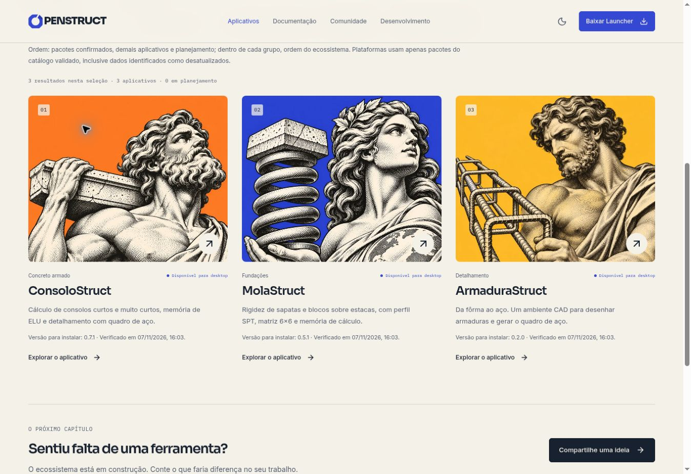

# Navegação institucional e confirmação de disponibilidade

Revisão: **07/11/2026**. Base: `90e411c1eec3275829e3efb66a86e9092fcd7cdd`.

## Destinos

- O menu **Desenvolvimento**, **Conheça o ecossistema** na home e **Construído em
  público** no rodapé levam a `/development`.
- A sugestão de ferramentas no catálogo e o diálogo de comunidade conduzem à
  escolha do projeto na central, em vez de abrir uma issue genérica no frontend.
- O repositório do frontend permanece público e explícito como **Código deste
  site**. A documentação e a licença MIT do site também têm identificação própria.
- As páginas e os cartões da central preservam os repositórios dos aplicativos.
  Não houve criação de organização, migração de repositórios ou mudança de visibilidade.

## Disponibilidade

O estado depende do catálogo público assinado, de seu canal estável e dos pacotes
verificados para cada ID. As regras e a compatibilidade criptográfica estão em
[CATALOGO-PUBLICO.md](CATALOGO-PUBLICO.md). A interface distingue consulta inicial,
ausência confirmada de pacote, erro de rede, publicação inválida, verificação
indisponível e último dado válido desatualizado.

Captura do preview local, tema claro. As versões vêm da consulta ao catálogo
público; não foram fixadas no componente.

## Validação

- `npm test`: **93 testes aprovados**, incluindo simulação de Ed25519 nativo
  ausente, assinatura adulterada, verificação estrita, falha fechada e causas distintas.
- `npm run build`: aprovado. A alternativa Ed25519 fica em chunk próprio de
  **13,06 kB gzip**, carregado somente quando o algoritmo nativo não é suportado.
- `npm audit --omit=dev`: nenhuma vulnerabilidade conhecida reportada.
- Catálogo real publicado em `2026-11-07T12:23:39.598Z` validado também pela alternativa:
  ConsoloStruct **0.7.1**, MolaStruct **0.5.1**, ArmaduraStruct **0.2.0**.
- Interface conferida em desktop, nos dois temas, e largura móvel simulada de
  **337 CSS px**: `scrollWidth === clientWidth`. Menu móvel e destinos institucionais
  inspecionados; acesso à central confirmado no navegador desktop.

Limites: a compatibilidade sem Ed25519 nativo foi simulada em testes Node; não se
executou um binário físico do Chrome 133 nem um aparelho móvel. A verificação
não instala os aplicativos nem atesta os bytes dos instaladores no navegador.
