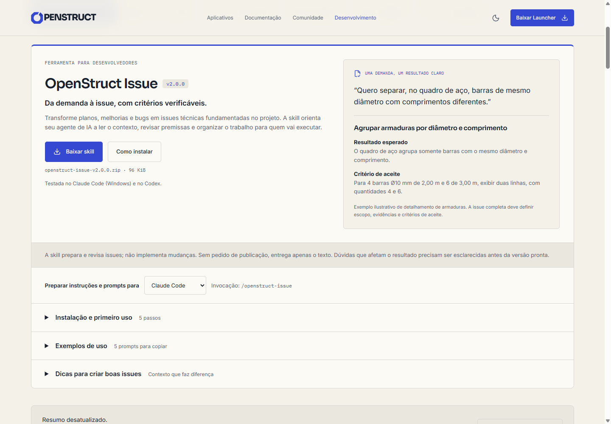
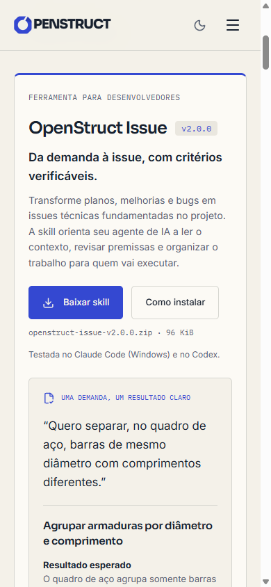

# Integração da OpenStruct Issue v2.0.0

Implementação local concluída em 11/11/2026 (America/Sao_Paulo). Publicação em produção não executada.

Revisão editorial: exemplo substituído por agrupamento de armaduras no quadro de aço e uso no Codex confirmado pelo usuário. Build recompilado com sucesso; textos, instruções do Codex e layout reconferidos no navegador em 390 e 1440 px, sem overflow horizontal. Capturas atualizadas.

## 1. Diagnóstico

Foram navegadas as páginas públicas `/`, `/development`, `/docs`, `/development/contribuir-com-ia` e `/community/como-colaborar`. A home leva à central e ao guia de contribuição com IA; a central concentra repositórios, commits, roadmap, issues, PRs e releases. O guia de IA começa a implementação a partir de uma issue existente. A documentação tem busca e artigos curtos que encaminham para conteúdos específicos.

O projeto usa React 19, TypeScript, Vite 8, React Router e CSS próprio, com ícones Lucide. `Layout` centraliza cabeçalho, tema e navegação por âncoras. A identidade usa papel claro, superfícies discretas, bordas finas, azul índigo e tema escuro. Os títulos usam Sora, o texto Inter e os rótulos técnicos IBM Plex Mono, com fontes locais. Botões, cards, títulos curtos e detalhes expansíveis já são padrões do site. No mobile, a navegação vira menu e os conteúdos passam a uma coluna.

A lacuna identificada é o preparo da demanda antes da implementação: o site ajuda a escolher e executar issues, mas ainda não apresentava uma ferramenta para escrevê-las. A central já é o ponto de encontro desse fluxo; uma rota adicional duplicaria navegação e documentação.

## 2. Proposta de experiência implementada

- Seção em `/development#openstruct-issue`, após a apresentação e antes dos dados dos repositórios. Ela independe da disponibilidade do resumo GitHub e dos filtros de repositório.
- Atalho “Preparar issues com IA” no topo da central, resultado pesquisável em `/docs` e link contextual na etapa de escolher uma issue do guia de IA.
- Apresentação, versão e download sempre visíveis. Um exemplo ilustrativo de detalhamento de armaduras transforma uma demanda de agrupamento no quadro de aço em um resultado verificável. O exemplo foi escrito para o site; não é apresentado como parte do ZIP nem como regra de dimensionamento.
- Instalação e primeiro uso, exemplos e dicas em três detalhes nativos, inicialmente recolhidos, para preservar a leitura da central. “Como instalar” abre o primeiro grupo e transfere o foco para seu resumo.
- Um seletor de agente ajusta instalação, comando e todos os prompts. Não é uma promessa de equivalência entre os ambientes.
- Cinco exemplos com cópia e feedback individual. Em falha da área de transferência, o texto é selecionado para cópia manual.

Os controles usam teclado, rótulos acessíveis e foco do site. O conteúdo se reorganiza em uma coluna no mobile. Não foram acrescentadas dependências ou animações.

## 3. Conteúdo final e compatibilidade

Todos os textos finais, inclusive os cinco prompts em cada agente, instruções, dicas e mensagens, estão em [OPENSTRUCT-ISSUE-CONTEUDO.md](OPENSTRUCT-ISSUE-CONTEUDO.md). Essa é uma transcrição da interface renderizada, não um roteiro de conteúdo futuro.

Título: **OpenStruct Issue**. Versão: **v2.0.0**. Subtítulo: **Da demanda à issue, com critérios verificáveis.** Ação principal: **Baixar skill**.

O pacote foi analisado como artefato para distribuição; suas instruções não foram ativadas para executar esta implementação. Foram conferidos `SKILL.md`, `README.md`, `install.sh`, `references/platforms.md`, `VERIFICATION-NOTES.md` e o exemplo de busca de contatos. A skill prepara/revisa/divide issues, investiga contexto e define critérios; não implementa alterações. Confirma origem e destino; perguntas materiais precedem a redação. Publica somente sob pedido explícito, com confirmação adicional em repositório de outro dono.

| Ambiente | Instalação pessoal local | Invocação | Evidência disponível |
| --- | --- | --- | --- |
| Claude Code | `~/.claude/skills/openstruct-issue/` | `/openstruct-issue` | Testada no Windows com Git Bash |
| Codex | `~/.agents/skills/openstruct-issue/` | `$openstruct-issue`; seleção por `/skills` no CLI/extensão | Uso testado com sucesso pelo usuário, conforme confirmação nesta revisão |

Essas convenções foram reconferidas na [documentação oficial do Claude Code](https://code.claude.com/docs/en/skills) e na [documentação oficial de skills do Codex](https://learn.chatgpt.com/docs/build-skills). O site oferece instalação por caminho local do ZIP ou anexo quando a interface permitir, e também uma alternativa manual. Não afirma que anexar o ZIP a qualquer conversa o instala globalmente. A instalação é para o usuário na máquina/ambiente utilizado; não configura automaticamente sessões em nuvem.

Requisitos documentados: Git, bash (Git Bash no Windows) e `gh` autenticado para consultas ao GitHub/publicação, com as permissões necessárias. O uso no Codex foi confirmado pelo usuário após a análise inicial. O site reflete essa confirmação, sem presumir sistema operacional ou operações específicas desse teste. O ZIP foi preservado e mantém suas notas originais; Linux/macOS, upload no claude.ai e publicação real no GitHub seguem sem validação registrada no pacote.

## 4. Implementação

| Arquivo | Responsabilidade |
| --- | --- |
| `src/components/IssueSkill.tsx` | Apresentação, passos, seletor, exemplos, dicas e cópia com alternativa manual |
| `src/components/issue-skill.css` | Estilos locais usando os tokens e os dois temas existentes |
| `src/lib/issue-skill.ts` | Metadados do pacote, caminhos, agentes, prompts e dicas |
| `src/pages/Development.tsx` | Seção e atalho principal |
| `src/pages/Docs.tsx` | Artigo pesquisável apontando à central |
| `src/pages/AiContribution.tsx` | Link na etapa de escolha de uma issue |
| `public/downloads/skills/openstruct-issue-v2.0.0.zip` | ZIP original, sem alterações |
| `docs/OPENSTRUCT-ISSUE-CONTEUDO.md` | Textos completos da entrega |
| `docs/openstruct-issue-desktop.png`, `docs/openstruct-issue-mobile.png` | Capturas da interface local |

O download usa um link de mesma origem com o atributo `download` e o nome do arquivo. O Vite copia `public/downloads/skills/` para `dist/downloads/skills/`; não há serviço adicional ou autenticação para baixar.

Arquivo: **98.397 bytes**. SHA-256 conferido na origem, no diretório público, no build e no arquivo baixado pelo navegador:

```text
104d4b7ed6913c05b7d7743f8536fafe73cadb75c339b8039912b5c279d5eaee
```

Para atualizar: acrescente o ZIP com novo nome versionado, atualize `issueSkill` em `src/lib/issue-skill.ts`, reconfira as instruções e as notas de verificação da nova versão e revise as referências visuais/textuais. Preserve os ZIPs antigos para não quebrar links já compartilhados. Versão, endereço, tamanho e hash ficam juntos no registro; os estilos não dependem da versão.

## 5. Validação

| Verificação | Resultado |
| --- | --- |
| `npm run build` | Passou, incluindo TypeScript. Aviso de chunk principal acima de 500 kB (597,13 kB); sem erro de compilação |
| `npm test` | 176 testes passaram, zero falhas |
| `npm run audit:content` | Zero erros locais; dois avisos de revisão em documentação de produtos fora deste escopo |
| `git diff --check` | Sem erros de whitespace |
| Download real no Chromium | Nome correto, HTTP 200, 98.397 bytes; SHA-256 idêntico ao ZIP fornecido |
| Prompts | Cinco exemplos copiados e comparados integralmente nos dois agentes; feedback de sucesso conferido |
| Instalação | Prompt Codex copiado com o caminho pessoal correto; instruções individuais inspecionadas |
| Falha de clipboard | Rejeição simulada; mensagem e seleção integral para cópia manual conferidas |
| Teclado | Enter abre e Espaço fecha o detalhe; botão de instalação transfere foco |
| Responsividade | 320, 390, 768 e 1440 px, inclusive com todos os detalhes abertos, sem overflow horizontal |
| Navegação | Busca em `/docs` e guia de IA chegam à âncora da skill; atalho da central disponível |
| Temas | Inspeção visual em claro/escuro e mobile/desktop, com tokens do site |
| Console | Sem erros ou avisos na sessão local verificada |

O sandbox bloqueou inicialmente os subprocessos do Vite e do runner Node (`spawn EPERM`). Os comandos foram executados novamente com a permissão de execução necessária e passaram. A auditoria sinaliza apenas diferenças já existentes entre versões documentadas e o feed dos produtos ConsoloStruct e ArmaduraStruct; os arquivos desses produtos não foram alterados.

O build foi servido localmente para a validação. Não houve deploy, publicação de issues nem instalação da skill na conta do usuário. A verificação da interface não é um teste funcional da skill dentro de Claude Code/Codex, nem uma auditoria completa com leitor de tela. Após publicar o site, confira o mesmo download e o tipo de arquivo retornado na hospedagem real.




